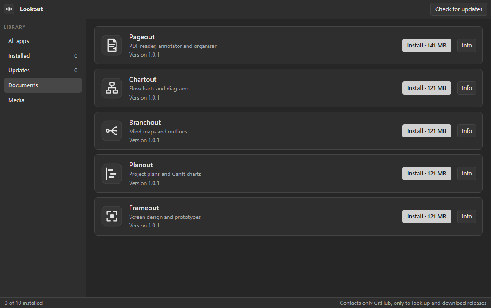
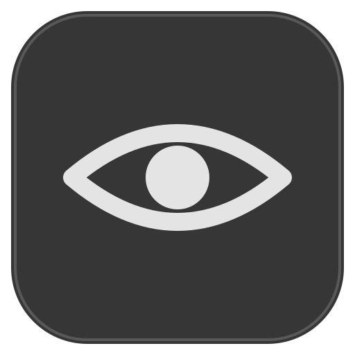

<h1 align="center">Lookout</h1>

<b>Install and update your apps</b> Version 1.0.8 for Windows · Free · Offline · No account

<a href="https://github.com/plawanpawin-byte/lookout-launcher/releases/latest"><b>Download Lookout</b></a> · <a href="https://github.com/plawanpawin-byte/lookout-launcher">Lookout launcher</a> · <a href="https://github.com/plawanpawin-byte/Lookout">All Lookout apps</a>

---

Lookout is the home for the Lookout apps. It lists all ten, tells you which ones you have, installs any of them with one click, opens them, removes them, and offers updates when a new version is published. Think of it as a small app store for one family of apps, without an account.

**On this page:** [In plain words](#in-plain-words) · [Who it is for](#who-it-is-for) · [Try it in 3 steps](#try-it-in-3-steps) · [Screenshots](#see-it-in-action) · [Features](#everything-it-can-do) · [How to use it](#how-to-use-it) · [Privacy](#private-by-design) · [Install](#install) · [Questions](#questions)

## In plain words

Lookout is the **app library** for the whole family. Instead of visiting ten web pages, you open Lookout, see every app with a picture and a short description, and press **Install**. It lists which apps you already have, shows when a newer version exists and updates them in one click. You can also open or remove an app from here.

It is like a small shop for one family of apps, with no account and no payment.

**Not for:** Lookout only installs and updates the Lookout apps. It does not manage other software.

## Who it is for

- **Everyone who wants more than one Lookout app**, in one place.
- **People who want to stay up to date** without watching for new releases.

## Try it in 3 steps

1. Open Lookout and use the left list to filter by **Documents** or **Media**.
2. Press **Install** next to an app; it downloads and sets itself up.
3. Come back later; **Updates** will list any app with a newer version.

## What is new in 1.0.8

A new look inspired by Google's own tools (AI Studio, Colab, Gemini): a calm dark charcoal theme, rounded pill buttons, a soft blue accent and roomier spacing. The app icon is now a colour logo so you can find Lookout at a glance in the Start menu and in the Lookout launcher. All screenshots below were taken again with the new look. The program now shows under its own name (not Electron) in Task Manager and the taskbar.

## In plain words

Lookout is the **app library** for the whole family. Instead of visiting ten web pages, you open Lookout, see every app with a picture and a short description, and press **Install**. It lists which apps you already have, shows when a newer version exists and updates them in one click. You can also open or remove an app from here.

It is like a small shop for one family of apps, with no account and no payment.

**Not for:** Lookout only installs and updates the Lookout apps. It does not manage other software.

## Who it is for

- **Everyone who wants more than one Lookout app**, in one place.
- **People who want to stay up to date** without watching for new releases.

## Try it in 3 steps

1. Open Lookout and use the left list to filter by **Documents** or **Media**.
2. Press **Install** next to an app; it downloads and sets itself up.
3. Come back later; **Updates** will list any app with a newer version.

## See it in action

### The library

Every app with its icon, a one-line description, its latest version and the download size. Press **Install**, and a few moments later the button changes to **Open**.

### Media apps

The sidebar filters the list. **Installed** shows what you have, **Updates** shows what has a newer version, and **Documents** and **Media** split the family into its two groups.

### Document apps

PDFout, Chartout, Branchout, Planout and Frameout. Press **Info** on any app to open its page with screenshots and details.

## Everything it can do

### Install and update
- One-click install of any app, with a progress bar
- Installs just for you; no administrator rights needed
- The **Updates** list shows apps with a newer release, and one click brings them up to date
- Installers are checked against the published checksum before they run
- Remove an app cleanly with its own uninstaller

### Stay in control
- Opens each app straight from the library
- **Check for updates** looks again whenever you like
- Shows how many of the ten apps are installed
- Never installs or updates anything by itself

## What it connects to

Lookout is the one app in the family that uses the internet, and only for this: it asks the public GitHub release pages which versions exist, and downloads an installer when you press Install or Update. Nothing else leaves your computer, and there is no tracking. The window itself has no network or file access of its own.

## Install

1. Open the [latest release](https://github.com/plawanpawin-byte/lookout-launcher/releases/latest) and download the file named **Lookout-Setup-** followed by the version number and **.exe**.
2. Run the installer. It installs just for you, so it does not ask for administrator rights.
3. Windows may show a blue **Windows protected your PC** screen because these installers are not signed with a paid certificate. Click **More info**, then **Run anyway**.
4. Open Lookout from the Start menu.

**Requirements:** Windows 10 or 11, 64-bit. About 500 MB of free disk space. No internet connection is needed to use the app.

## Questions

**Why does Windows warn me about the installers?**
They are not signed with a paid code-signing certificate. Click **More info**, then **Run anyway**. Lookout checks every download against its published checksum first.

**Does it work offline?**
You can open and use every installed app offline. The library needs a connection only to look for new versions and to download.

**Where are the apps installed?**
In your user profile, so no administrator rights are needed. Each app also appears in Windows Settings under Installed apps.

Released under the MIT License.

**Does it need the internet?**  
Only to look up and download releases from GitHub. Nothing about you or your files is sent.

**Do I need Lookout to use the apps?**  
No. Each app can be installed on its own from its releases page.

**Does it need an account?**  
No.

**Does it need the internet?**  
Only to look up and download releases from GitHub. Nothing about you or your files is sent.

**Do I need Lookout to use the apps?**  
No. Each app can be installed on its own from its releases page.

**Does it need an account?**  
No.

## About Lookout

Lookout is part of **[Lookout](https://github.com/plawanpawin-byte/Lookout)**: ten small, private Windows apps for documents and media that share one look and one promise, that your files stay on your computer. Install and update them together with the [Lookout launcher](https://github.com/plawanpawin-byte/lookout-launcher).

| | App | What it is for | Code |
| --- | --- | --- | --- |
|  | **Lookout** | Install, open and update all the apps below | [GitHub](https://github.com/plawanpawin-byte/lookout-launcher) |
|  | **PDFout** | Read, annotate and sign PDFs | [GitHub](https://github.com/plawanpawin-byte/pdfout) |
|  | **Chartout** | Flowcharts, org charts and diagrams | [GitHub](https://github.com/plawanpawin-byte/chartout) |
|  | **Branchout** | Mind maps and outlines | [GitHub](https://github.com/plawanpawin-byte/branchout) |
|  | **Planout** | Project plans and Gantt timelines | [GitHub](https://github.com/plawanpawin-byte/planout) |
|  | **Frameout** | App and web screen design with click-through prototypes | [GitHub](https://github.com/plawanpawin-byte/frameout) |
|  | **Cutout** | Video editing on a timeline | [GitHub](https://github.com/plawanpawin-byte/cutout) |
|  | **Shiftout** | Convert and compress video and audio, make GIFs | [GitHub](https://github.com/plawanpawin-byte/shiftout) |
|  | **Castout** | Record your screen | [GitHub](https://github.com/plawanpawin-byte/castout) |
|  | **Mendout** | Check and repair damaged video, audio, pictures and PDFs | [GitHub](https://github.com/plawanpawin-byte/mendout) |
|  | **Tuneout** | Record and edit audio | [GitHub](https://github.com/plawanpawin-byte/tuneout) |

Released under the MIT License.
