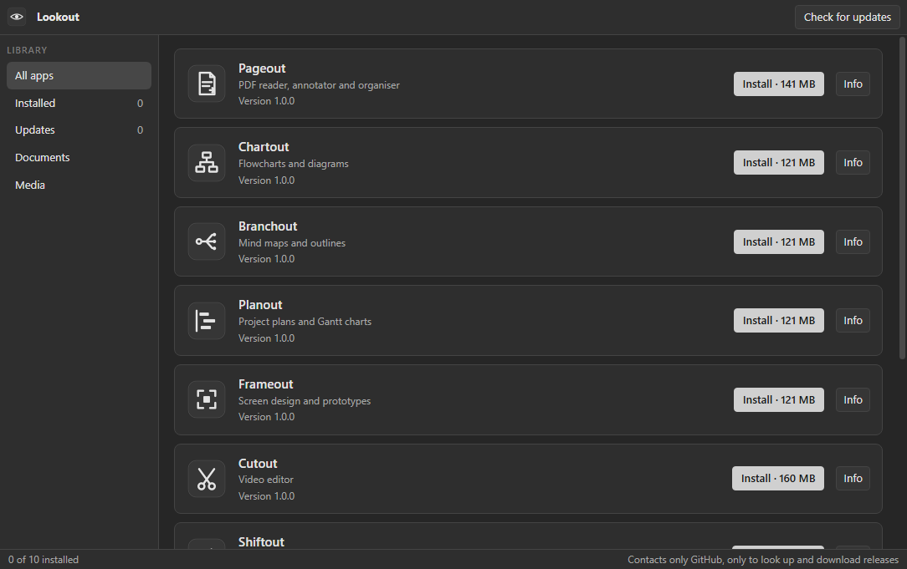

# Lookout

The home for the Lookout family of private, offline apps for Windows. Lookout lists every app, installs it with one click, keeps it up to date and opens it for you. The gray, quiet design stays out of the way.

## What you can do

- **See all ten apps** in one list, grouped into Documents and Media
- **Install** any app with one click, no wizard to click through
- **Update** one app or all of them when a new version is out
- **Open** an installed app straight from the list
- **Remove** an app you no longer need. Your own files are never touched
- Downloads are checked for completeness and against their checksum before they run

## The apps

| App | What it does |
| --- | --- |
| Pageout | PDF reader, annotator and organiser |
| Chartout | Flowcharts and diagrams |
| Branchout | Mind maps and outlines |
| Planout | Project plans and Gantt charts |
| Frameout | Screen design and prototypes |
| Cutout | Video editor |
| Shiftout | Video and audio converter |
| Castout | Screen recorder |
| Mendout | Repair and check media files |
| Tuneout | Audio editor |

## Your privacy

Lookout contacts GitHub only to read public release information and to download installers when you ask. It sends no personal information, has no account and does no tracking. The apps it installs work fully offline.

## Download

Get **Lookout-Setup-1.0.0.exe** from the [Releases](../../releases/latest) page and run it.

Released under the MIT License.
